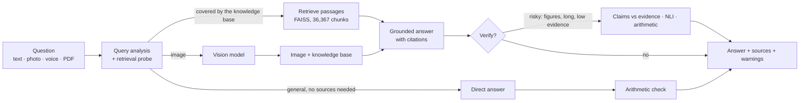

# EduRoute AI

**An evidence-grounded study assistant for engineering students.** Ask by text,
photo, voice or your own PDF. EduRoute decides per question whether to answer
directly, retrieve from a 26-branch engineering knowledge base, read the image, or
combine them. It cites its sources and checks its own claims and calculations
before showing the answer.

- **Coverage:** 26 engineering branch groups, 289 subjects, 1,462 source articles, 36,367 indexed passages.
- **Inputs:** text, image or camera photo, voice (Whisper), uploaded PDF, Word or text documents.
- **Answers:** 2-, 5- and 10-mark exam formats; numbered citations; workflow diagrams on request; read-aloud.
- **Checking:**
  - every claim is matched to evidence;
  - figures are checked against the sources;
  - an NLI contradiction check;
  - written calculations and units are recomputed;
  - truth tables and short code snippets read off images are worked out exactly by built-in tools;
  - at most one automatic revision;
  - warnings shown to the student.
- **Agentic RAG:** comparisons and multi-part questions are planned into sub-searches; evidence coverage is checked and the search refined; unsupported claims get targeted evidence before the revision. Every step is visible in the developer view.
- **Context engineering and memory:** sources are de-duplicated and compressed to a token budget per answer type; conversation memory is budgeted; follow-ups ("What are its advantages?") are resolved to their topic.
- **Inference optimisation:** a shared answer cache answers repeated questions instantly; query embeddings are cached; a stable prompt prefix is reused by the model server.
- **Runs on open models:** Qwen2.5-3B (text) and Qwen2.5-VL 3B/7B (images) via Ollama, MiniLM embeddings, FAISS.
- **Production features:**
  - access codes;
  - per-student rate limits and an answer queue;
  - privacy-preserving logs with automatic retention;
  - an operations dashboard;
  - auto-restart and backups;
  - an end-to-end smoke test.

## How it works



The router's in-domain threshold is calibrated on the index (Youden's J, τ = 0.491)
and checked on held-out questions. Verification runs only where it pays off.

## Measured results

| What | Result |
|---|---|
| Retrieval, 50 engineering questions | a relevant source in the top 5 for every question; MRR 0.94 |
| Router on 60 unseen questions | **98.2%** correct (all 30 in-scope kept; 25 of 26 out-of-scope rejected) |
| Adaptive vs always retrieving (250 answers) | **19% fewer tokens**, same median latency |
| Adaptive vs always verifying | **53% fewer tokens** |
| Forcing retrieval on out-of-scope questions | 76% unsupported claims (13% in scope), which is why the router matters |
| Answers citing their sources | 16% → 86% after the prompt fixes the benchmark exposed |
| Image questions (8 known-answer images, 3B vision model, CPU) | adaptive **8/8** with every fact right (4/8 before the exact reasoning tools); image-only 7/8 |
| Full benchmark, all 140 questions on a laptop CPU | 0 failures; 84% of grounded answers cite sources; 30/30 out-of-scope questions kept ungrounded |
| Follow-up questions resolved by memory (300 cases) | right topic in the top 5: 0.3% → **97.3%** |
| Comparisons with agentic retrieval (40 pairs) | evidence for both sides: 22.5% → **75%** |
| Context engineering, answer time on the CPU | **−34%** time, −33% prompt tokens; the best passage kept in 100% of cases |
| Answer cache | repeated question 9 s → 0 s; **0 false hits** across 4,950 pairs of different questions |
| Speech recognition, synthetic Indian-English voices | 4.3% word error rate |

Human grading of answer correctness is in progress (Evaluation Studio). Details,
negative results and every run: [docs/PROGRESS.md](docs/PROGRESS.md),
[project report (PDF)](docs/EduRoute_AI_Project_Report.pdf).

## Quick start

### A. Run the whole app on a free Colab GPU (easiest)

1. On your computer: `venv\Scripts\python colab\make_bundle.py` creates `colab/eduroute_colab_bundle.zip`.
2. Open [colab/EduRoute_Colab_App.ipynb](colab/EduRoute_Colab_App.ipynb) in Google Colab and choose *Runtime → T4 GPU*, then *Run all*.
3. Upload the bundle when asked. About 10 minutes later the notebook prints:
   - a public `https://…trycloudflare.com` link;
   - the **student access code**;
   - the **team code**.

[colab/EduRoute_Colab_Benchmark.ipynb](colab/EduRoute_Colab_Benchmark.ipynb) runs
the full evaluation the same way (about 2 hours; it resumes from Google Drive).

### B. On your own computer

```powershell
python -m venv venv
venv\Scripts\python -m pip install -r requirements.txt
copy .env.example .env
winget install Ollama.Ollama
ollama pull qwen2.5:3b            # text model, ~2 GB
ollama pull qwen2.5vl:3b          # optional: image questions
venv\Scripts\streamlit run app.py   # or double-click run_app.cmd
```

Without a language model the app still works in a clearly labelled "source
excerpts" mode. On a laptop CPU an answer takes 1–3 minutes; a GPU takes seconds.

**Full evaluation on a CPU, unattended:** double-click `run_cpu_evaluation.cmd`.
It runs overnight (8–10 h): smoke test, all 140 benchmark questions, images,
voice and the claim export. It keeps the laptop awake, and if stopped it resumes
where it left off. Progress: `outputs\cpu_evaluation.log`.

### C. On a GPU server, pod or Kubernetes cluster

```bash
bash deploy/gpu/preflight.sh      # read-only check of the server
bash deploy/gpu/setup.sh          # venv with CUDA PyTorch, Ollama, models, random access codes
bash deploy/gpu/services.sh start # app + models; services.sh watch keeps them running
python -m deploy.smoke_test       # every route, real models, pass/fail
```

Kubernetes (e.g. a university DGX): `bash deploy/k8s/deploy.sh up`. Everything is in
[docs/GPU_SERVER.md](docs/GPU_SERVER.md).

## Who uses which part

| Who | Page | Access |
|---|---|---|
| Students | **Ask EduRoute**: chat, sources, verification, download the conversation as study notes | access code |
| Project team | **Evaluation studio**: blind grading, claim labels, voice recordings, images, syllabus review | team code |
| Operators | **Operations**: questions per day, routes, answer times, quality signals, ratings, failures | team code |

## Configuration

All settings come from environment variables or `.env` (never committed). See
[.env.example](.env.example) for the laptop and
[deploy/gpu/server.env](deploy/gpu/server.env) for a server. The most used:

| Setting | Default | Purpose |
|---|---|---|
| `EDUROUTE_LLM_BASE_URL`, `EDUROUTE_LLM_MODEL` | Ollama, `qwen2.5:3b` | Any OpenAI-compatible server (Ollama, vLLM) |
| `EDUROUTE_VISION_BASE_URL`, `EDUROUTE_VISION_MODEL` | empty (off) | Image questions, e.g. `qwen2.5vl:3b` or `:7b` |
| `EDUROUTE_NLI_MODEL` | empty | Contradiction check, e.g. `cross-encoder/nli-deberta-v3-xsmall` |
| `EDUROUTE_ACCESS_CODE`, `EDUROUTE_STUDIO_CODE` | empty (open) | Required for any public deployment |
| `EDUROUTE_MAX_QUESTIONS_PER_HOUR`, `EDUROUTE_MAX_CONCURRENT_ANSWERS` | 0 (no limit) | Server sets 60 and 4 |
| `EDUROUTE_LOG_QUERY_TEXT` | false | Logs keep a hash of each question, not its text |
| `EDUROUTE_LOG_RETENTION_DAYS` | 30 | Older log records are deleted automatically |

## Privacy and safety

- Questions are logged only as a one-way hash with timings and the route taken.
- Uploaded images, documents and recordings are processed in memory and never stored.
- Answers are labelled as study aids. Verification problems are shown to the student, not hidden.
- Public deployments refuse to start without an access code, and the team tools use a separate code.

## Development

```powershell
venv\Scripts\python -m pip install -r requirements-dev.txt
venv\Scripts\python -m pytest -q            # all tests; add -m "not slow" to skip the app tests
```

| Task | Command |
|---|---|
| Collect the engineering knowledge base (cached, resumable) | `python -m src.data_collection.build_engineering_corpus` |
| Build the engineering index | `python -m src.rag.build_index_v4 --dataset engineering_v1` |
| Add missing topics without a rebuild | `python -m src.data_collection.extend_corpus [--dry-run]` |
| Compare coverage with the AICTE curriculum | `python -m src.data_collection.compare_aicte` |
| Ingest a permitted PDF into the index | `python -m src.data_collection.pdf_ingestion notes.pdf --title ... --subject-id ... --license "..."` |
| Retrieval benchmark | `python -m evaluation.evaluate_retrieval --benchmark retrieval_engineering_v1.jsonl --configs engineering_v1:dense` |
| Router calibration / held-out check | `python -m evaluation.calibrate_router --version engineering_v1` / `python -m evaluation.check_router_heldout` |
| System benchmark (5 strategies; resumable) | `python -m evaluation.run_system_benchmark [--sample 20] [--resume <partial.jsonl>]` |
| Image benchmark | `python -m evaluation.run_image_benchmark` |
| Voice word error rate | `python -m evaluation.evaluate_asr <folder>` |
| Claim labels; human grading | `python -m evaluation.claim_labels export/score ...`; `python -m evaluation.analyse_grading ...` |
| Report PDF | `python docs/report/build_report.py` |

```
app.py, pages/          Streamlit app: chat, evaluation studio, operations dashboard
src/router/             query analysis, calibrated adaptive router
src/rag/                cleaning, chunking, FAISS index, retrieval, uploaded documents
src/llm/                model back-ends (OpenAI-compatible, transformers, extractive), prompts, diagrams
src/verification/       claims, evidence, NLI, arithmetic and unit check
src/vision/ src/voice/  image input and vision model; Whisper speech, text-to-speech
src/utils/              access control and limits, logging, retention, catalogue
config/                 settings, 26 branch catalogues, router calibration
evaluation/             benchmarks, evaluators, results
deploy/                 GPU server, pod and Kubernetes deployment; smoke test
colab/                  Colab notebooks (full app; evaluation) and bundle builder
docs/                   progress log, report, deployment guides
```

## Team

Syed Mohammed Yaseen, Mohammed Ayaan, Arfath Khan. B.Tech capstone project.
